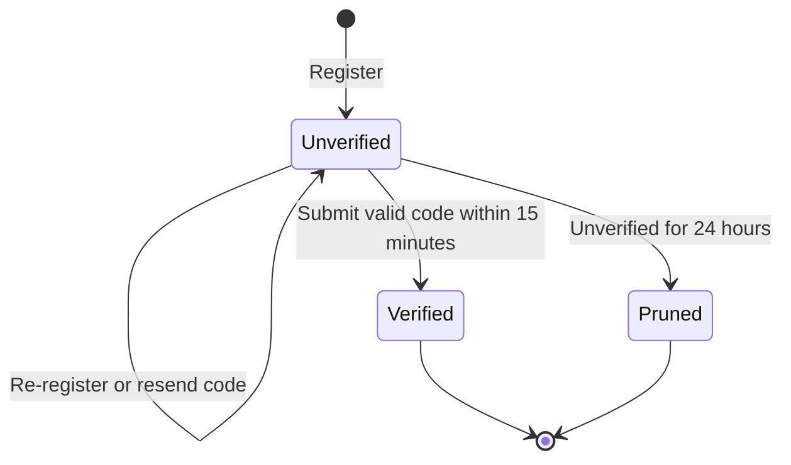

# Authentication and User Lifecycle

Authentication and account routes are defined in [`backend/routes/api.php`](../../backend/routes/api.php). Protected API routes use Sanctum bearer tokens. The registered user roles are defined in [`UserRole`](../../backend/app/Enums/UserRole.php).

Registration, login, forgot-password, and resend-verification requests accept only `@student.laverdad.edu.ph` and `@laverdad.edu.ph` addresses. Registration shares its domain rule through [`HasUserRules`](../../backend/app/Http/Requests/Concerns/HasUserRules.php); the other requests declare the same suffix rule in their Form Requests. Email or code validation failures return 422, and a resend inside the 60-second cooldown returns 429. See [`RegisterRequest`](../../backend/app/Http/Requests/Api/V1/Auth/RegisterRequest.php), [`LoginRequest`](../../backend/app/Http/Requests/Api/V1/Auth/LoginRequest.php), [`ForgotPasswordRequest`](../../backend/app/Http/Requests/Api/V1/Auth/ForgotPasswordRequest.php), and [`ResendVerificationRequest`](../../backend/app/Http/Requests/Api/V1/Auth/ResendVerificationRequest.php).

## Registration and verification

Registration creates an unverified account and queues a six-digit verification email. Verification codes expire after 15 minutes. An unverified account can register again with the same email; the existing record is updated and its creation time is refreshed. A verification resend has a 60-second cooldown. These rules are implemented in [`AuthController`](../../backend/app/Http/Controllers/Api/V1/Auth/AuthController.php) and [`VerificationController`](../../backend/app/Http/Controllers/Api/V1/Auth/VerificationController.php).

[`User::prunable`](../../backend/app/Models/User.php) selects unverified users at least 24 hours old. The daily `model:prune` task runs this model's query. The scheduler is configured in [`routes/console.php`](../../backend/routes/console.php).

## Login and tokens

Login rejects an unverified user and sends another verification code. On successful login, the application deletes the user's existing Sanctum tokens and creates a new `auth-token`. Logout deletes the current token. The configured Sanctum expiration is 24 hours, and the daily `sanctum:prune-expired --hours=24` task removes expired token records according to Sanctum's command behavior.

## Password reset

For a valid email address, forgot-password requests return the same success message whether or not an account exists. For a known email, the controller creates a reset token that expires after 15 minutes and queues a reset email. If queuing throws, the failure is logged and the same success message is returned. Resetting a password deletes all of that user's Sanctum tokens and removes the reset-token record. See [`PasswordResetController`](../../backend/app/Http/Controllers/Api/V1/Auth/PasswordResetController.php).

## Google OAuth

Google sign-in is available through GET routes `/api/v1/auth/google/redirect` and `/api/v1/auth/google/callback`, defined in [`web.php`](../../backend/routes/web.php), rather than in [`api.php`](../../backend/routes/api.php). The login form opens the redirect route in a popup when possible; the frontend reads the callback's redirect parameters and sends the result to the opener. If a popup cannot be opened, the flow continues in the current window. See [`LoginForm.jsx`](../../frontend/web/src/features/auth/components/LoginForm.jsx) and [`auth.js`](../../frontend/web/src/lib/auth.js).

Socialite uses the backend session to validate OAuth state across the redirect and callback. The callback accepts only the two La Verdad email domains. A new Google account is redirected to the registration form with profile details prefilled; an existing unverified account receives a verification email and is redirected with an error. An existing verified account has its old Sanctum tokens deleted, receives a new token in the redirect URL, and is redirected to the dashboard or equipment page according to role. The frontend stores the token in `localStorage` and removes it from the visible URL. These behaviors are implemented in [`OAuthController`](../../backend/app/Http/Controllers/Api/V1/Auth/OAuthController.php) and [`auth.js`](../../frontend/web/src/lib/auth.js).
