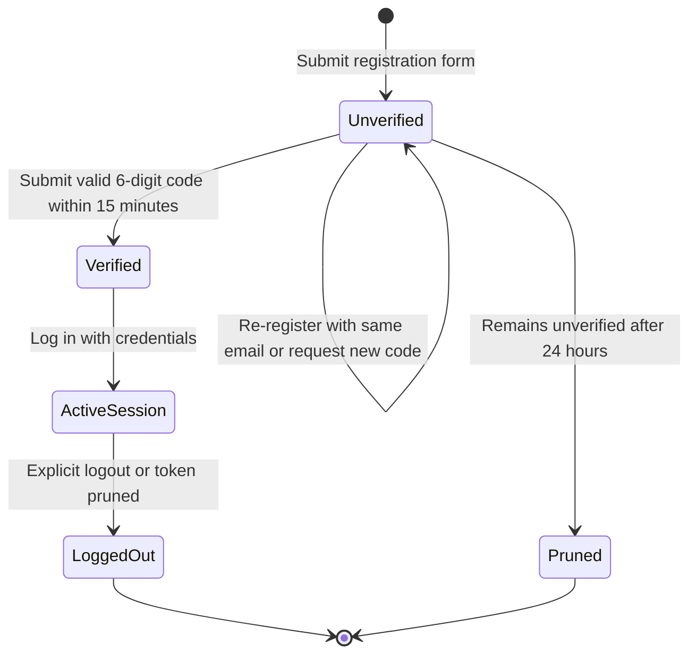

# Authentication and user lifecycle

Broadtrack uses role-based access control and email verification. Authentication routes are configured in [`backend/routes/api.php`](../../backend/routes/api.php) and [`backend/routes/web.php`](../../backend/routes/web.php). API requests use Laravel Sanctum bearer tokens.

User roles are defined by [`UserRole`](../../backend/app/Enums/UserRole.php): `borrower`, `admin`, and `sysadmin`.

## Allowed email domains

Accounts are restricted to these email domains:

- Student: `@student.laverdad.edu.ph`
- Faculty and staff: `@laverdad.edu.ph`

[`HasUserRules`](../../backend/app/Http/Requests/Concerns/HasUserRules.php) supplies the shared `schoolEmailRule()` used by [`RegisterRequest`](../../backend/app/Http/Requests/Api/V1/Auth/RegisterRequest.php) and user management requests ([`StoreUserRequest`](../../backend/app/Http/Requests/Api/V1/StoreUserRequest.php), [`UpdateUserRequest`](../../backend/app/Http/Requests/Api/V1/UpdateUserRequest.php)). [`UpdateProfileRequest`](../../backend/app/Http/Requests/Api/V1/UpdateProfileRequest.php) uses `HasUserRules` for name rules and does not validate email.

The [login](../../backend/app/Http/Requests/Api/V1/Auth/LoginRequest.php), [forgot-password](../../backend/app/Http/Requests/Api/V1/Auth/ForgotPasswordRequest.php), [resend-verification](../../backend/app/Http/Requests/Api/V1/Auth/ResendVerificationRequest.php), and [verify-email](../../backend/app/Http/Requests/Api/V1/Auth/VerifyEmailRequest.php) requests declare the `ends_with:...` domain rule directly rather than sharing it through the trait. Unauthorized domains fail validation with HTTP 422.

## Registration and email verification

### Verification rules

1. **Registration**: [`AuthController::register`](../../backend/app/Http/Controllers/Api/V1/Auth/AuthController.php) creates an unverified user record (`email_verified_at = null`) and calls [`VerificationController::sendVerification`](../../backend/app/Http/Controllers/Api/V1/Auth/VerificationController.php), which generates a 6-digit numeric code, stores it on the user record, and enqueues the verification email.
2. **Re-registration**: Submitting an existing unverified email updates account fields, resets `created_at` to `now()`, and issues a new code.
3. **Expiration**: Codes expire after 15 minutes (HTTP 422).
4. **Resend cooldown**: `POST /api/v1/resend-verification` enforces a 60-second cooldown based on `verification_sent_at` (HTTP 429).
5. **Pruning**: Unverified accounts older than 24 hours are removed daily by `model:prune --model=App\Models\User` via [`User::prunable`](../../backend/app/Models/User.php). See [Scheduled tasks](./scheduled-tasks.md).

## Login and token management

- **Unverified accounts**: Unverified login attempts return HTTP 403, generate a fresh code, and enqueue a verification email.
- **One token per user**: Successful login deletes prior Sanctum tokens before creating a new `auth-token`.
- **Token expiration**: Sanctum tokens expire after 24 hours; daily `sanctum:prune-expired --hours=24` deletes tokens that have been expired for over 24 hours.
- **Logout**: `POST /api/v1/logout` deletes the current access token.

## Password reset workflow

1. **Same response for all emails**: `POST /api/v1/forgot-password` returns "Reset link sent to your email." (HTTP 200) whether the email exists or not, preventing enumeration.
2. **Reset token**: Registered accounts receive a 64-character token in `password_reset_tokens` valid for 15 minutes.
3. **Token check**: `POST /api/v1/check-reset-token` validates parameters without consuming the token and returns `{ valid: boolean }` inside `data` in the success response. The frontend switches to the forgot-password form if the token is invalid or expired.
4. **Reset**: `POST /api/v1/reset-password` validates the token, hashes the new password, revokes active Sanctum tokens, and removes the reset token.

## Google OAuth flow

Google sign-in provides authentication for school accounts:

- **Route config**: Defined in [`backend/routes/web.php`](../../backend/routes/web.php) under `/api/v1/auth/google/redirect` and `/api/v1/auth/google/callback` using web session middleware to validate state.
- **Client flow**: Opens redirect endpoint in popup window, falling back to full-window redirect if blocked.
- **Domain check**: Verifies Google email ends with `@student.laverdad.edu.ph` or `@laverdad.edu.ph`.
- **New account**: Redirects to registration form with prefilled query parameters (`firstname`, `lastname`, `email`, `profile_picture`).
- **Unverified account**: Generates and enqueues a verification code, redirecting with a notice to verify.
- **Verified account**: Revokes prior tokens, creates new `auth-token`, and redirects to `/dashboard` (admin/sysadmin) or `/equipment` (borrower).
- **Client token storage**: [`frontend/web/src/lib/auth.js`](../../frontend/web/src/lib/auth.js) saves the token to `localStorage` and removes the token parameter from the address bar.
