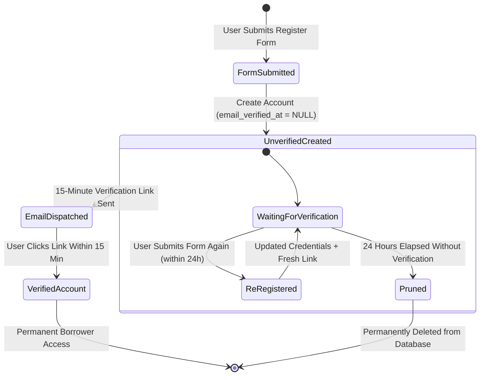

# Authentication & User Lifecycle

BroadTrack restricts user authentication to institution email domains (`@student.laverdad.edu.ph` and `@laverdad.edu.ph`). Unverified registrations are kept for 24 hours before automated deletion.

---

## Registration & Verification Lifecycle



---

## 1. Domain Validation & Anchoring

In [`HasUserRules.php`](file:///home/sam/git/broadtrack/backend/app/Http/Requests/Concerns/HasUserRules.php):

- Student and employee email rules explicitly enforce the `@` anchor to prevent domain suffix spoofing:
    ```php
    protected function schoolEmailRule(): string
    {
        return 'ends_with:@student.laverdad.edu.ph,@laverdad.edu.ph';
    }
    ```
- This rule is enforced across [`RegisterRequest.php`](file:///home/sam/git/broadtrack/backend/app/Http/Requests/Api/V1/Auth/RegisterRequest.php), [`LoginRequest.php`](file:///home/sam/git/broadtrack/backend/app/Http/Requests/Api/V1/Auth/LoginRequest.php), and [`ForgotPasswordRequest.php`](file:///home/sam/git/broadtrack/backend/app/Http/Requests/Api/V1/Auth/ForgotPasswordRequest.php).

---

## 2. Unverified Registration Handling & Token Verification

In [`RegisterRequest.php`](file:///home/sam/git/broadtrack/backend/app/Http/Requests/Api/V1/Auth/RegisterRequest.php) and [`VerificationController.php`](file:///home/sam/git/broadtrack/backend/app/Http/Controllers/Api/V1/Auth/VerificationController.php):

- Email uniqueness is enforced only against verified accounts:
    ```php
    Rule::unique('users')->whereNotNull('email_verified_at')
    ```
- If a user registered previously but did not verify within the 15-minute link window, submitting the form again updates their existing unverified record and sends a new verification link.
- In [`VerificationController.php`](file:///home/sam/git/broadtrack/backend/app/Http/Controllers/Api/V1/Auth/VerificationController.php), requests missing the `token` query parameter or supplying an invalid non-string token are rejected before hitting the database, preventing unintended queries against verified users where `verification_token` is `NULL`.

---

## 3. 24-Hour Model Pruning

In [`User.php`](file:///home/sam/git/broadtrack/backend/app/Models/User.php):

- Implements Laravel's `Prunable` trait:
    ```php
    public function prunable(): Builder
    {
        return static::whereNull('email_verified_at')
            ->where('created_at', '<=', now()->subHours(24));
    }
    ```
- Unverified accounts older than 24 hours are removed by the daily `model:prune` task scheduled in `routes/console.php`.

---

## 4. Google OAuth Domain Verification

In [`OAuthController.php`](file:///home/sam/git/broadtrack/backend/app/Http/Controllers/Api/V1/Auth/OAuthController.php):

- Domain Filter: Only accounts with `@student.laverdad.edu.ph` or `@laverdad.edu.ph` emails are allowed to authenticate via `Str::is(...)`. External domains (e.g. `@gmail.com`) are immediately rejected with an error redirect.
- Unverified Redirect: If an unverified user logs in via Google, they are redirected with a message to check their email for the verification link.
- Role Redirect:
    ```php
    $target = $user->isAdmin() ? '/admin' : '/borrow';
    return redirect($frontendUrl.$target.'?token='.$token);
    ```

---

## 5. Token Revocation & Password Reset

In [`PasswordResetController.php`](file:///home/sam/git/broadtrack/backend/app/Http/Controllers/Api/V1/Auth/PasswordResetController.php):

- When a borrower or administrator successfully resets their password, all active personal access tokens are immediately revoked:
    ```php
    $user->tokens()->delete();
    ```
- Token Lifetime: Configured in `config/sanctum.php` as 24 hours (`60 * 24`).
- Pruning Schedule: Configured in `routes/console.php`:
    ```php
    Schedule::command('sanctum:prune-expired --hours=24')->daily()->timezone('Asia/Manila');
    ```
