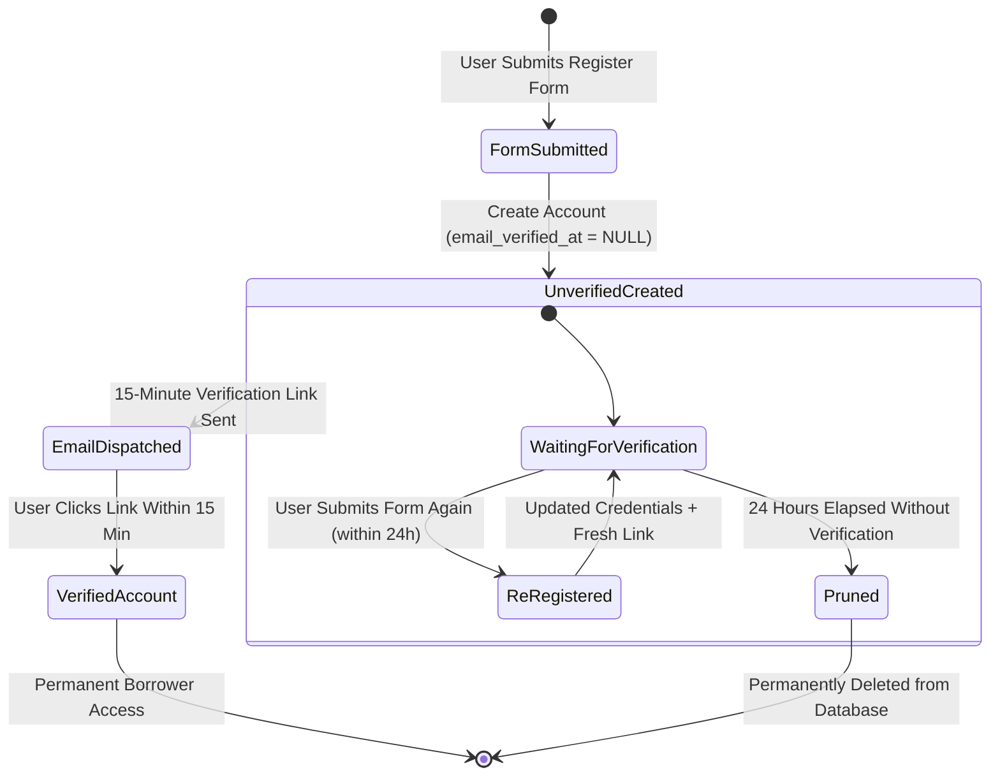

# Authentication & User Lifecycle

BroadTrack restricts user authentication to institution email domains (`@student.laverdad.edu.ph` and `@laverdad.edu.ph`). Unverified registrations are kept for 24 hours before automated deletion.

---

## Registration & Verification Lifecycle



---

## 1. Unverified Registration Handling

In [`RegisterRequest.php`](file:///home/sam/git/broadtrack/backend/app/Http/Requests/Api/V1/Auth/RegisterRequest.php):
- Email uniqueness is enforced only against verified accounts:
  ```php
  Rule::unique('users')->whereNotNull('email_verified_at')
  ```
- If a user registered previously but did not verify within the 15-minute link window, submitting the form again updates their existing unverified record and sends a new verification link.
- If an already-verified email is submitted, validation fails with `422 Unprocessable Entity` (`"The email has already been taken."`).

---

## 2. 24-Hour Model Pruning

In [`User.php`](file:///home/sam/git/broadtrack/backend/app/Models/User.php):
- Implements Laravel's `Prunable` trait:
  ```php
  public function prunable(): Builder
  {
      return static::whereNull('email_verified_at')
          ->where('created_at', '<=', now()->subHours(24));
  }
  ```
- Unverified accounts older than 24 hours are removed by the daily `model:prune` task.

---

## 3. Google OAuth Domain Verification

In [`OAuthController.php`](file:///home/sam/git/broadtrack/backend/app/Http/Controllers/Api/V1/Auth/OAuthController.php):
- Domain Filter: Only accounts with `@student.laverdad.edu.ph` or `@laverdad.edu.ph` emails are allowed to authenticate.
- Unverified Redirect: If an unverified user logs in via Google, they are redirected with a message to check their email for the verification link.
- Role Redirect:
  ```php
  $target = $user->isAdmin() ? '/admin' : '/borrow';
  return redirect($frontendUrl.$target.'?token='.$token);
  ```

---

## 4. Personal Access Token Expiration

- Token Lifetime: Configured in `config/sanctum.php` as 24 hours (`60 * 24`).
- Pruning Schedule: Configured in `routes/console.php`:
  ```php
  Schedule::command('sanctum:prune-expired --hours=24')->daily();
  ```
- Tokens expired for more than 24 hours are deleted from the `personal_access_tokens` table.
