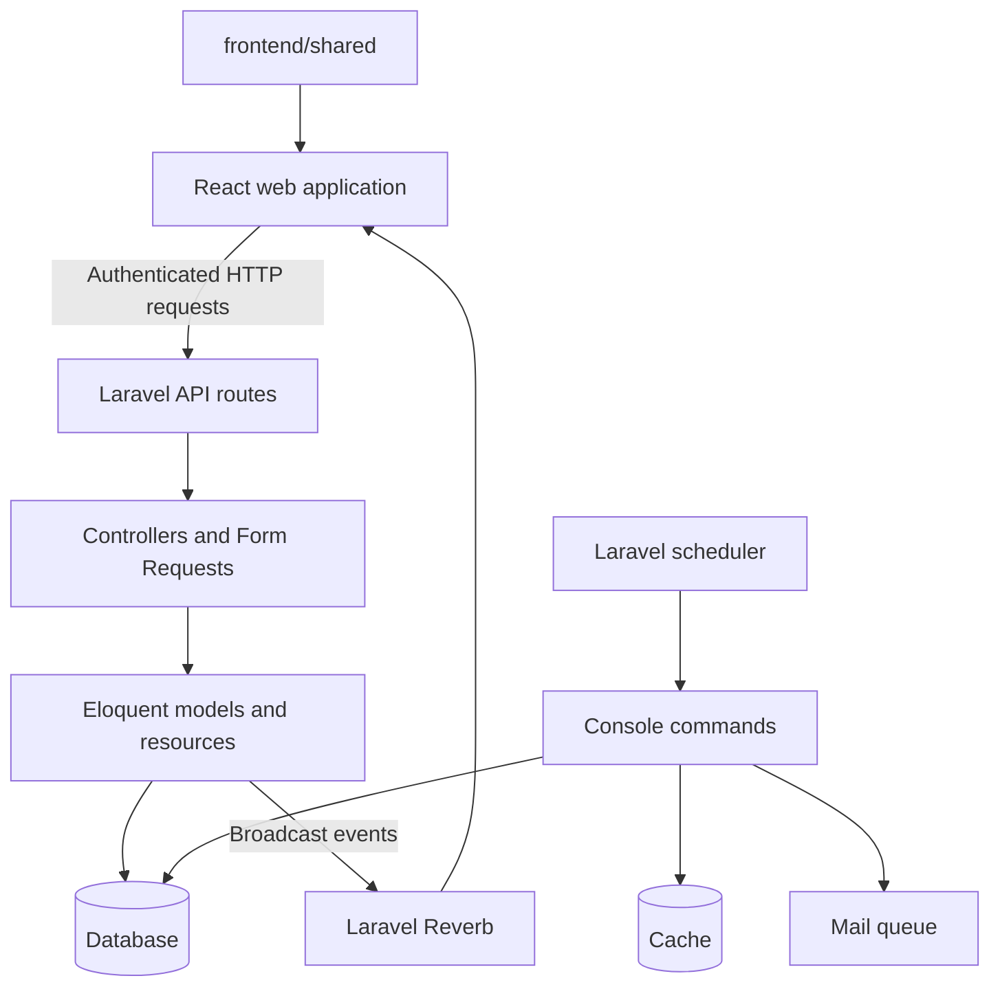

# System Architecture Overview

BroadTrack has a Laravel API, a React web application, shared frontend utilities, and WebSocket broadcasts for live updates.

## Repository areas

- [`backend/`](../../backend/) contains the Laravel API, database models, console commands, and server tests.
- [`frontend/web/`](../../frontend/web/) contains the React application, organized by feature.
- [`frontend/shared/`](../../frontend/shared/) contains shared constants, schemas, browser utilities, and HTTP and WebSocket client factories used by the web application.

The backend dependency manifest is [`backend/composer.json`](../../backend/composer.json); the web package dependencies are in [`frontend/web/package.json`](../../frontend/web/package.json). These files are the source of truth for the installed frameworks and libraries.

## Request and update flow

Routes apply authentication and role middleware where needed. Form Requests validate input, controllers coordinate work, and API Resources shape many JSON responses. Some framework exceptions, file downloads, and no-content responses have their own response shapes.

Booking and equipment observers broadcast updates through Laravel Reverb. The booking update event dispatches after the database transaction commits. These observers do not invalidate application cache or frontend query caches; the web client listens for broadcasts and invalidates relevant TanStack Query entries.

## Time and storage

The booking table uses timezone-naive `DATETIME` columns. Laravel reads `APP_TIMEZONE` from configuration, whose fallback is UTC; the example environment sets `Asia/Manila`. Frontend booking helpers format calendar values in `Asia/Manila`. Eloquent date casts serialize as UTC ISO strings, so callers should use the date helpers rather than slicing timestamp text to get a Manila calendar day. See the [borrowing lifecycle](../workflows/borrowing-lifecycle.md).
