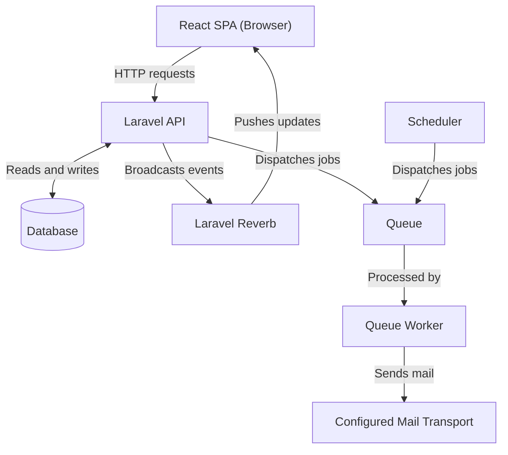

# System overview

Broadtrack is an equipment borrowing and inventory tracking system for La Verdad Christian College.

## Users

- **Borrowers**: Browse equipment, submit requests, track active bookings, and download slips.
- **Administrators**: Review requests, record physical returns, and manage equipment status.
- **System administrators**: Manage accounts, roles, and administrative permissions.

## Components and services

- **Web client**: React 19 single-page application in [`frontend/web/`](../../frontend/web/). Communicates with backend over HTTP and receives real-time WebSocket events.
- **Shared code**: Library in [`frontend/shared/`](../../frontend/shared/). Provides shared constants, schemas, and utilities to the web client (imported code, not a standalone service).
- **Backend API**: Laravel 13 application in [`backend/`](../../backend/). Serves `/api/v1` endpoints and executes business logic.
- **Database**: Relational database for core models (users, equipment, bookings). Migrations are in [`backend/database/migrations/`](../../backend/database/migrations/).
- **WebSocket server**: Laravel Reverb server configured in [`backend/config/reverb.php`](../../backend/config/reverb.php) broadcasting inventory and booking updates.
- **Queue and scheduler**: Laravel scheduler and queue worker configured in [`backend/routes/console.php`](../../backend/routes/console.php) and started in [`backend/entrypoint.sh`](../../backend/entrypoint.sh). Jobs dispatch to the configured queue driver.
- **External integrations**: Google OAuth for authentication, Cloudinary via [`CloudinaryService`](../../backend/app/Services/CloudinaryService.php) for media storage, and a configured mail transport for queued email notifications. Transport options (Brevo API, SMTP, and others) are defined in [`backend/config/mail.php`](../../backend/config/mail.php).

## Architecture

## Deployment configuration

- **Frontend**: The CI pipeline deploys only the frontend. Built with Bun and deployed to Firebase Hosting via [`.github/workflows/deploy.yml`](../../.github/workflows/deploy.yml) with SPA rewrites in [`frontend/web/firebase.json`](../../frontend/web/firebase.json).
- **Backend**: Container image defined in [`backend/Dockerfile`](../../backend/Dockerfile). Caddy with FrankenPHP serves Laravel Octane, configured via [`backend/Caddyfile`](../../backend/Caddyfile), routing API traffic and proxying Reverb. Background workers and Octane start in [`backend/entrypoint.sh`](../../backend/entrypoint.sh).

## Related documentation

- [Authentication and user lifecycle](auth-lifecycle.md): OAuth, token management, and account cleanup.
- [Scheduled tasks](scheduled-tasks.md): Cron schedules, reminder commands, and model pruning.
- [Borrowing and equipment lifecycle](../workflows/borrowing-lifecycle.md): Booking statuses, availability, and returns.
- [API endpoints reference](../reference/api-endpoints.md): `/api/v1` routes, permissions, and payloads.
