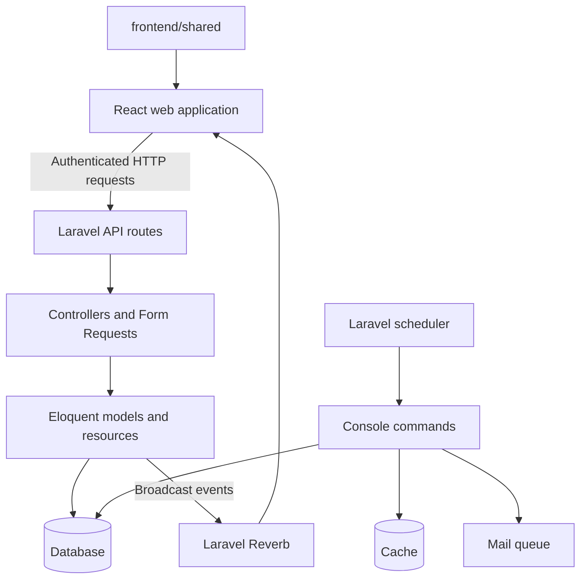

# System Architecture Overview

BroadTrack lets borrowers request equipment, admins manage equipment and bookings, and sysadmins manage user accounts. It has a Laravel backend, a React web application, shared frontend utilities, and WebSocket broadcasts for live updates. The role-specific pages are defined in [`router.jsx`](../../frontend/web/src/app/router.jsx); API access is enforced separately by routes, middleware, and policies.

## System context

| Participant or system     | Interaction with BroadTrack                                                                                                                           |
| ------------------------- | ----------------------------------------------------------------------------------------------------------------------------------------------------- |
| Borrower                  | Browses equipment, submits requests, checks bookings and calendar entries, and downloads booking slips.                                               |
| Admin                     | Reviews bookings, manages inventory, records returns, and exports reports.                                                                            |
| Sysadmin                  | Has admin access and manages user accounts.                                                                                                           |
| Google                    | Provides the OAuth identity used by the Google sign-in callback. See the [authentication lifecycle](./auth-lifecycle.md).                             |
| Cloudinary                | Receives equipment image uploads and deletion requests from the backend. See [`CloudinaryService`](../../backend/app/Services/CloudinaryService.php). |
| Configured mail transport | Sends queued verification, password reset, contact, and return reminder messages. Queueing a message does not prove delivery.                         |

This table follows the scope of a [C4 system context view](https://c4model.com/diagrams/system-context): users and external systems around BroadTrack.

## Running parts

| Part                       | Responsibility                                                                                                                                                   | Source                                                                                                             |
| -------------------------- | ---------------------------------------------------------------------------------------------------------------------------------------------------------------- | ------------------------------------------------------------------------------------------------------------------ |
| React web app              | Presents borrower and admin pages; calls the API and listens for broadcasts.                                                                                     | [`frontend/web/`](../../frontend/web/)                                                                             |
| Laravel application        | Serves API and Google OAuth routes; applies validation and authorization; reads and writes data.                                                                 | [`backend/routes/`](../../backend/routes/)                                                                         |
| Database                   | Stores users, equipment, bookings, queue records, and other Laravel tables. The example environment selects SQLite; deployment may configure another connection. | [`migrations`](../../backend/database/migrations/) and [database configuration](../../backend/config/database.php) |
| Queue worker and scheduler | Process queued mail and run expiry, reminder, and pruning commands.                                                                                              | [`frontend/package.json`](../../frontend/package.json) and [scheduled tasks](./scheduled-tasks.md)                 |
| Laravel Reverb             | Relays booking, equipment, and user update events to connected web clients.                                                                                      | [`backend/config/reverb.php`](../../backend/config/reverb.php)                                                     |

`frontend/shared` is imported by the web app and is not a separately running service. The [C4 container model](https://c4model.com/diagrams/container) uses running applications and data stores for this level of detail.

## Repository areas

- [`backend/`](../../backend/) contains the Laravel API, database models, console commands, and server tests.
- [`frontend/web/`](../../frontend/web/) contains the React application, organized by feature.
- [`frontend/shared/`](../../frontend/shared/) contains shared constants, schemas, browser utilities, and HTTP and WebSocket client factories used by the web application.

The backend dependency manifest is [`backend/composer.json`](../../backend/composer.json); the web package dependencies are in [`frontend/web/package.json`](../../frontend/web/package.json). These files are the source of truth for the installed frameworks and libraries.

## Request and update flow

Routes apply authentication and role middleware where needed. Form Requests validate input, controllers coordinate work, and API Resources shape many JSON responses. Some framework exceptions, file downloads, and no-content responses have their own response shapes.

Booking and equipment observers broadcast updates through Laravel Reverb. The booking update event dispatches after the database transaction commits. These observers do not invalidate application cache or frontend query caches; the web client listens for broadcasts and invalidates relevant TanStack Query entries.

## Deployment configuration

The repository's [deploy workflow](../../.github/workflows/deploy.yml) builds the web app and deploys it to Firebase Hosting on pushes to `main` or `dev` that match its path filters. [`firebase.json`](../../frontend/web/firebase.json) serves the built app and rewrites routes to `index.html`. The backend [`Caddyfile`](../../backend/Caddyfile) configures FrankenPHP and proxies WebSocket paths to Reverb. These files describe intended deployment behavior; they do not establish which services are currently running in production.

## Time and storage

The booking table uses timezone-naive `DATETIME` columns. Laravel reads `APP_TIMEZONE` from configuration, whose fallback is UTC; the example environment sets `Asia/Manila`. Frontend booking helpers format calendar values in `Asia/Manila`. Eloquent date casts serialize as UTC ISO strings, so callers should use the date helpers rather than slicing timestamp text to get a Manila calendar day. See the [borrowing lifecycle](../workflows/borrowing-lifecycle.md).
