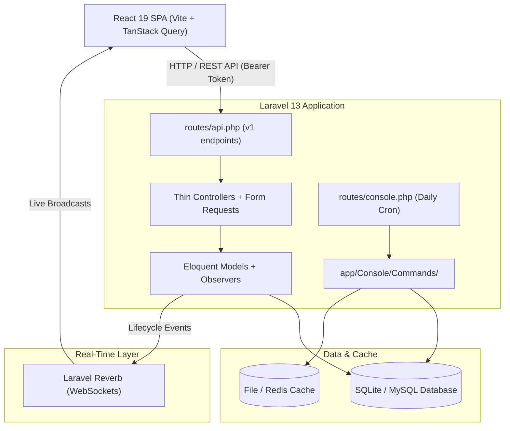

# System Architecture Overview

BroadTrack is organized as a decoupled Single-Page Application (SPA) communicating with a stateless Laravel REST API and a real-time WebSocket broadcasting server.

---

## High-Level Architecture Diagram

---

## Core Architecture Principles

### 1. Monorepo with Shared Domain Core
The repository contains 3 main code roots:
- `backend/`: Pure Laravel API serving typed JSON resources.
- `frontend/web/`: React single-page application with grouped feature views.
- `frontend/shared/`: Platform-agnostic domain logic (Zod schemas, constants, date formatters, and search utilities).

### 2. Thin Controllers & Form Requests
- Controllers never handle direct database queries or raw validation.
- Validation is delegated to dedicated Form Request classes (`app/Http/Requests/Api/V1/`).
- Responses are formatted via API Resources (`app/Http/Resources/Api/V1/`).
- Authorization is guarded by auto-discovered Policies (`app/Policies/`).

### 3. Asynchronous Model Lifecycle & Broadcasting
- Model side-effects (cache busting, notification dispatching, WebSocket broadcasts) are placed in Eloquent Observers (`app/Observers/`) attached via `#[ObservedBy]`.
- Keeps controllers thin and guarantees side-effects run regardless of where a model mutation originates.

---

## Key Libraries & Dependencies

### Backend Dependencies (`backend/composer.json`)
- `laravel/framework`
- `laravel/octane`
- `laravel/reverb`
- `laravel/sanctum`
- `laravel/socialite`
- `tamtamchik/namecase`
- `pestphp/pest`
- `laravel/pint`
- `mockery/mockery`
- `fakerphp/faker`

### Frontend Dependencies (`frontend/web/package.json`)
- `react` / `react-dom`
- `react-router-dom`
- `@tanstack/react-query`
- `zustand`
- `axios`
- `laravel-echo` / `pusher-js`
- `tailwindcss`
- `lucide-react`
- `jsbarcode`
- `flatpickr` / `react-flatpickr`
- `zod`
- `@fontsource/poppins`
- `oxlint`
- `prettier`
