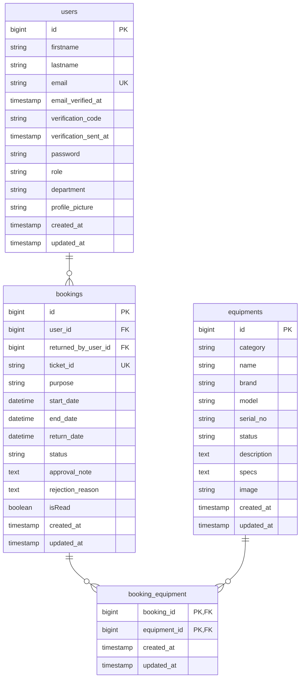

# Database schema and models

The database schema is managed by Laravel migrations. Eloquent models in `backend/app/Models/` define relationships and logic. Migrations and models are the source of truth.

PHP enums define status and category values without lookup tables. Values are stored as plain strings; Form Requests validate inputs and Eloquent casts them to enum instances.

## Entity-relationship diagram

> [!NOTE]
> The `bookings.returned_by_user_id` column is a nullable foreign key referencing `users.id` to record which staff member accepted returned equipment. It is omitted as a second relationship line in the diagram above to keep the core booking flow clear.

## Schema sources and models

### Users

- Model: [`User`](../../backend/app/Models/User.php)
- Migration: [`0001_01_01_000004_create_users_table.php`](../../backend/database/migrations/0001_01_01_000004_create_users_table.php)
- Table: `users`
- Stores user accounts for borrowers, staff, and administrators. The `role` and `department` columns store string values cast to [`UserRole`](../../backend/app/Enums/UserRole.php) and [`Department`](../../backend/app/Enums/Department.php) enums.
- Relationships:
    - `bookings()`: `HasMany` [`Booking`](../../backend/app/Models/Booking.php) on `user_id` (reservations requested by the user).
    - `returnedBookings()`: `HasMany` [`Booking`](../../backend/app/Models/Booking.php) on `returned_by_user_id` (reservations where the user recorded equipment return).

### Equipments

- Model: [`Equipment`](../../backend/app/Models/Equipment.php)
- Migration: [`0001_01_01_000005_create_equipments_table.php`](../../backend/database/migrations/0001_01_01_000005_create_equipments_table.php)
- Table: `equipments`
- Stores physical equipment inventory. The `category` and `status` columns store string values cast to [`EquipmentCategory`](../../backend/app/Enums/EquipmentCategory.php) and [`EquipmentStatus`](../../backend/app/Enums/EquipmentStatus.php) enums.
- Relationships:
    - `bookings()`: `BelongsToMany` [`Booking`](../../backend/app/Models/Booking.php) via pivot table `booking_equipment` with timestamps.

### Bookings

- Model: [`Booking`](../../backend/app/Models/Booking.php)
- Migration: [`0001_01_01_000006_create_bookings_table.php`](../../backend/database/migrations/0001_01_01_000006_create_bookings_table.php)
- Table: `bookings`
- Stores reservations, approval decisions, scheduled borrowing windows, and return timestamps. The `status` column stores string values cast to the [`BookingStatus`](../../backend/app/Enums/BookingStatus.php) enum. Booking schedule times (`start_date`, `end_date`, `return_date`) use timezone-naive `DATETIME` storage; see the [borrowing lifecycle](../workflows/borrowing-lifecycle.md#request-validation-and-time-handling) for date handling.
- Relationships:
    - `user()`: `BelongsTo` [`User`](../../backend/app/Models/User.php) on `user_id`.
    - `returnedByUser()`: `BelongsTo` [`User`](../../backend/app/Models/User.php) on `returned_by_user_id` (nullable).
    - `equipments()`: `BelongsToMany` [`Equipment`](../../backend/app/Models/Equipment.php) via pivot table `booking_equipment` with timestamps.

### Booking equipment (pivot)

- Migration: [`0001_01_01_000007_create_booking_equipment_table.php`](../../backend/database/migrations/0001_01_01_000007_create_booking_equipment_table.php)
- Table: `booking_equipment`
- Joins `bookings` and `equipments` with a composite primary key (`booking_id`, `equipment_id`) and cascading foreign key deletions.

## Enums

Models use backed string enums for casting and validation:

- [`BookingStatus`](../../backend/app/Enums/BookingStatus.php): `pending`, `approved`, `rejected`, `returned`, `cancelled`
- [`EquipmentStatus`](../../backend/app/Enums/EquipmentStatus.php): `available`, `booked`, `borrowed`, `maintenance`
- [`UserRole`](../../backend/app/Enums/UserRole.php): `borrower`, `admin`, `sysadmin`
- [`EquipmentCategory`](../../backend/app/Enums/EquipmentCategory.php): `Camera`, `Video`, `Audio`, `Lighting`, `Support`, `Cables`, `Others`
- [`Department`](../../backend/app/Enums/Department.php): `BA Broadcasting`, `BS Information Systems`, `Associate in Computer Technology`, `BS Accountancy`, `BS Accountancy in Information Systems`, `BS Social Work`
