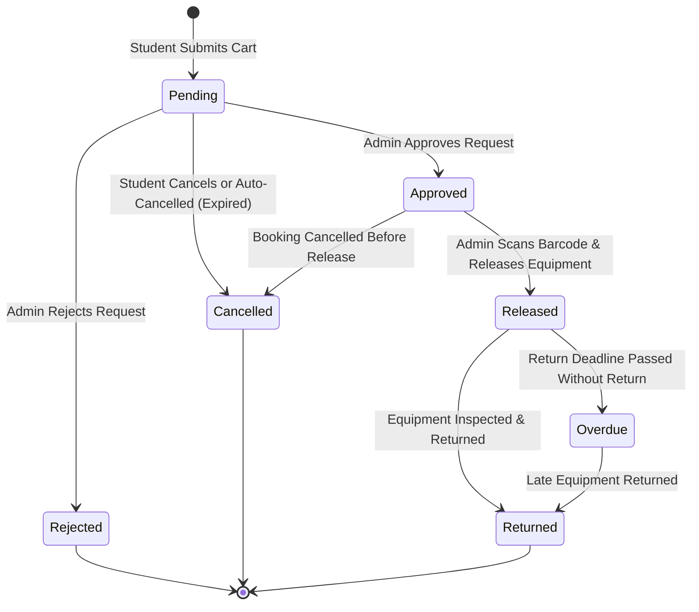

# Borrowing & Equipment Lifecycle

This document explains the lifecycle of equipment items and borrowing transactions in BroadTrack.

---

## Booking State Machine

---

## 1. Booking Status Definitions

| Status          | Description                                                                                               | Equipment Availability                               |
| --------------- | --------------------------------------------------------------------------------------------------------- | ---------------------------------------------------- |
| **`Pending`**   | Student submitted a request; awaiting administrator approval.                                             | Equipment remains available for other requests.      |
| **`Approved`**  | Administrator approved the request; ticket ID and barcode generated.                                      | Equipment is reserved for the scheduled time window. |
| **`Rejected`**  | Administrator rejected the request (with optional notes).                                                 | Equipment is released back to available stock.       |
| **`Released`**  | Student picked up the equipment; admin confirmed physical release.                                        | Equipment is marked `In Use`.                        |
| **`Returned`**  | Equipment returned and inspected; transaction completed.                                                  | Equipment returns to `Available`.                    |
| **`Cancelled`** | Booking cancelled by student, admin, or automatically cancelled if reservation window elapses unreviewed. | Equipment released back to available stock.          |

---

## 2. Equipment Status Definitions

In [`EquipmentStatus.php`](file:///home/sam/git/broadtrack/backend/app/Enums/EquipmentStatus.php):

- **`Available` (`available`)**: In stock and ready to be borrowed.
- **`Booked` (`booked`)**: Reserved by an approved booking for an upcoming reservation window.
- **`Borrowed` (`borrowed`)**: Currently released to a student and in active use.
- **`Maintenance` (`maintenance`)**: Defective or undergoing repair. Excluded from booking availability checks.

---

## 3. Data Integrity & Validation Guards

- **Cart Requirement (`min:1`):** In [`StoreBookingRequest.php`](file:///home/sam/git/broadtrack/backend/app/Http/Requests/Api/V1/StoreBookingRequest.php), booking requests require at least one equipment item (`equipment_ids: required|array|min:1`).
- **Independent Per-Item Bookings:** When checking out multiple equipment items in a single cart submission, BroadTrack creates independent `Booking` records per equipment item inside a single database transaction. Each equipment item receives a dedicated ticket ID, allowing administrators to approve, reject, release, or return items individually.
- **Overlap Validation Scope:** Availability and schedule conflict checks in [`StoreBookingRequest.php`](file:///home/sam/git/broadtrack/backend/app/Http/Requests/Api/V1/StoreBookingRequest.php) and [`BookingController.php`](file:///home/sam/git/broadtrack/backend/app/Http/Controllers/Api/V1/BookingController.php) only lock equipment against active `Approved` and `Released` bookings. Unapproved `Pending` requests do not block other students from requesting equipment.
- **Past-Date Approval Guard:** In [`BookingController.php`](file:///home/sam/git/broadtrack/backend/app/Http/Controllers/Api/V1/BookingController.php), administrators are blocked from approving bookings whose scheduled reservation period has already passed (`422 Unprocessable Entity`).
- **Deletion Protection:** In [`EquipmentController.php`](file:///home/sam/git/broadtrack/backend/app/Http/Controllers/Api/V1/EquipmentController.php), equipment cannot be deleted if it is currently booked/borrowed or has historical booking records (`422 Unprocessable Entity`), preserving transaction history and audit slips.
