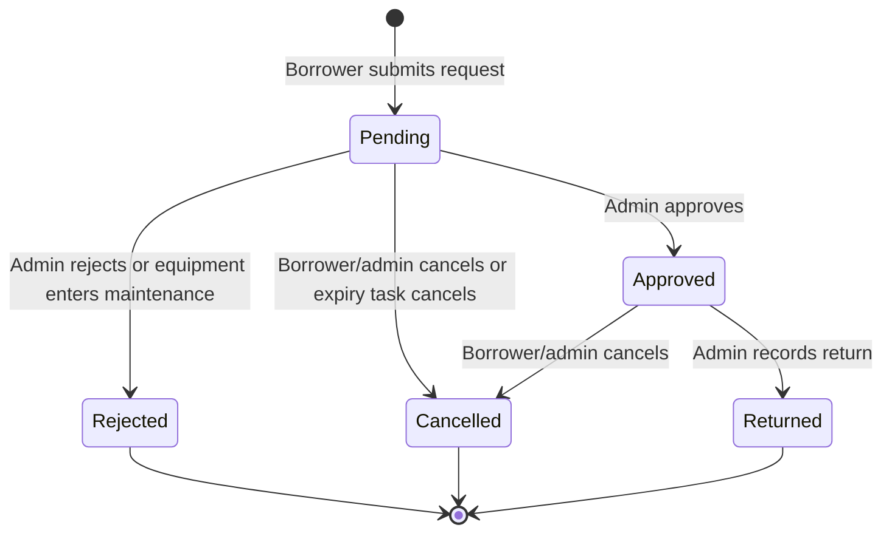

# Borrowing and Equipment Lifecycle

Booking states and equipment inventory states are separate. Their current values are defined in [`BookingStatus`](../../backend/app/Enums/BookingStatus.php) and [`EquipmentStatus`](../../backend/app/Enums/EquipmentStatus.php).

## Booking states

The persisted booking statuses are `pending`, `approved`, `rejected`, `returned`, and `cancelled`. There is no persisted `released` state or barcode release transition. `is_overdue` is computed for an approved booking whose end date has passed; it is not a stored booking status. See [`Booking`](../../backend/app/Models/Booking.php) and [`BookingController`](../../backend/app/Http/Controllers/Api/V1/BookingController.php).

| Status      | Meaning                                         |
| ----------- | ----------------------------------------------- |
| `pending`   | Waiting for an administrator's decision.        |
| `approved`  | Approved and included in active booking checks. |
| `rejected`  | Rejected by an administrator.                   |
| `returned`  | Return recorded by an administrator.            |
| `cancelled` | Cancelled by a user or by the expiry task.      |

## Equipment states

Equipment status values are `available`, `booked`, `borrowed`, and `maintenance`. [`Equipment::resolveStatuses`](../../backend/app/Models/Equipment.php) preserves items marked as `maintenance` or `borrowed`; for other items, it reports `booked` when at least one approved booking is attached. This resolved status is returned by the equipment API and does not itself update the stored equipment status. Returning a booking changes its booking status and return fields; it does not directly overwrite equipment status.

The live inventory status dropdown and [`EquipmentController::update`](../../backend/app/Http/Controllers/Api/V1/EquipmentController.php) enforce the following transition rules:

- **Available**: Indicates the equipment is free for reservations. An item that is currently booked cannot be set directly to available; the backend returns a 422 error (`Cannot change status while equipment is currently booked.`).
- **Booked**: Resolved by the equipment API when an item has an approved booking. Manually setting status to booked without an approved booking is rejected with a 422 error (`Equipment can only be marked as booked through an approved booking.`). The booking form can still offer booked equipment when the requested interval does not overlap the approved reservation; the server checks availability for the requested dates.
- **Borrowed**: Marks equipment in physical possession outside the normal reservation cycle. Setting status to borrowed while an item is currently booked is rejected with a 422 error. While marked borrowed, new booking submissions and approvals for this item are blocked.
- **Maintenance**: Marks equipment undergoing inspection, repair, or servicing. When switched to maintenance, the backend automatically transitions all attached `pending` and `approved` bookings to `rejected` with the rejection reason `Equipment is under maintenance.` Booking updates are broadcast to connected clients.

Maintenance and borrowed equipment are excluded from availability. Availability checks are repeated while booking transitions run in a transaction with equipment locks; preserve these checks when changing booking logic.

## Request validation and dates

[`StoreBookingRequest`](../../backend/app/Http/Requests/Api/V1/StoreBookingRequest.php) validates the requested equipment and dates. The start must be at or after the current minute; earlier minutes are rejected. The server checks conflicts against approved bookings. The request stores timezone-naive `DATETIME` values, so the database values are not inherently UTC. Eloquent serializes date casts as UTC ISO timestamps; do not derive a Manila calendar date by slicing that timestamp. The API resource formats date labels in `Asia/Manila`, and the frontend uses [`frontend/shared/util/date.js`](../../frontend/shared/util/date.js) to parse and display booking dates consistently.

The request summary uses [`useBookingDateDefaults`](../../frontend/web/src/features/borrow/request/useBookingDateDefaults.js). While open, an automatic start follows the current minute and an automatic end is set to the next full hour (for example, 3:08 becomes 4:00). Manually selected dates are preserved while editing; closing and reopening resets the automatic defaults. There is no fixed school-hours restriction.

## Booking integrity

- A booking request needs at least one equipment item.
- A request with multiple equipment IDs creates one booking per item in the same database transaction, so each item has its own ticket and lifecycle.
- Equipment conflict checks use approved bookings and half-open intervals: an existing booking conflicts when its start is before the requested end and its end is after the requested start. Pending requests do not reserve equipment.
- Borrowers can cancel their own pending or approved bookings; admins can cancel any pending or approved booking. Other statuses cannot be cancelled through this route.
- Approval rechecks availability under transaction locks. Do not remove the lock or conflict recheck when changing transitions.
- Equipment with booking history cannot be deleted, preserving transaction records.

The model observers broadcast booking and equipment updates. [`BookingUpdated`](../../backend/app/Events/BookingUpdated.php) dispatches after commit; [`EquipmentUpdated`](../../backend/app/Events/EquipmentUpdated.php) broadcasts immediately. These observers do not invalidate frontend query caches; the web client handles its own query invalidation and WebSocket refresh behavior.
