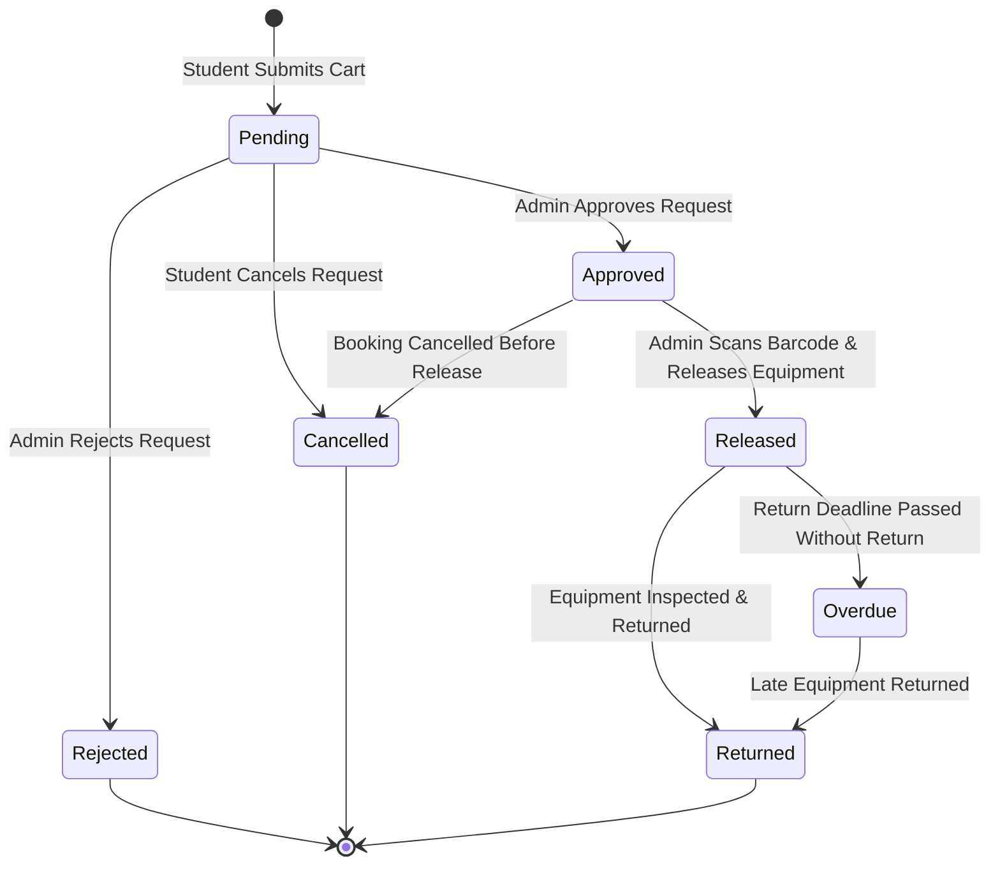

# Borrowing & Equipment Lifecycle

This document explains the lifecycle of equipment items and borrowing transactions in BroadTrack.

---

## Booking State Machine

---

## 1. Booking Status Definitions

| Status | Description | Equipment Availability |
|---|---|---|
| **`Pending`** | Student submitted a request; awaiting administrator approval. | Equipment is temporarily reserved. |
| **`Approved`** | Administrator approved the request; ticket ID and barcode generated. | Equipment is reserved for the scheduled time window. |
| **`Rejected`** | Administrator rejected the request (with optional notes). | Equipment is released back to available stock. |
| **`Released`** | Student picked up the equipment; admin confirmed physical release. | Equipment is marked `In Use`. |
| **`Returned`** | Equipment returned and inspected; transaction completed. | Equipment returns to `Available`. |
| **`Cancelled`** | Booking cancelled by student or admin before release. | Equipment released back to available stock. |

---

## 2. Equipment Status Definitions

In [`EquipmentStatus.php`](file:///home/sam/git/broadtrack/backend/app/Enums/EquipmentStatus.php):
- **`Available`**: Ready to be borrowed.
- **`Under Maintenance`**: Defective or undergoing repair. Cannot be booked.
- **`Retired`**: Permanently decommissioned. Excluded from catalog views.
