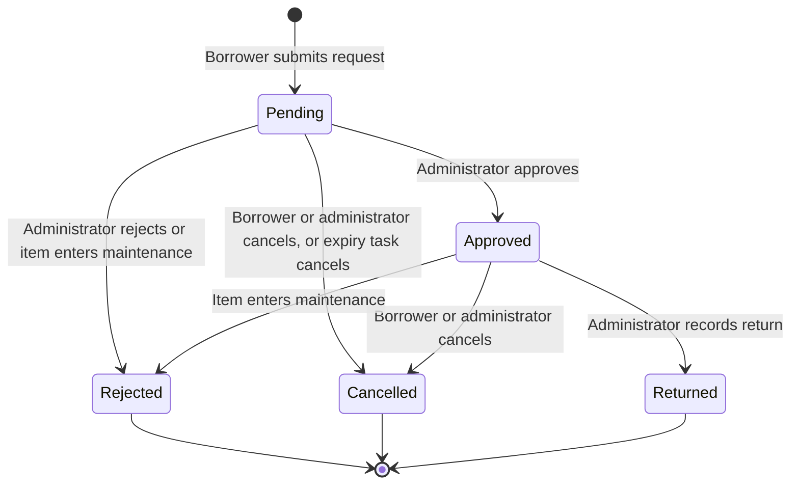

# Borrowing and equipment lifecycle

Booking requests and equipment items each have their own lifecycle. They interact during availability checks, approvals, maintenance transitions, and returns.

Statuses are defined by enums [`BookingStatus`](../../backend/app/Enums/BookingStatus.php) and [`EquipmentStatus`](../../backend/app/Enums/EquipmentStatus.php).

## Booking status lifecycle



### Booking statuses

| Status        | Value       | Behavior                                                                                                                                                        |
| :------------ | :---------- | :-------------------------------------------------------------------------------------------------------------------------------------------------------------- |
| **Pending**   | `pending`   | Newly submitted request awaiting administrative review. Does not block other borrowers from requesting the same item during overlapping periods.                |
| **Approved**  | `approved`  | Confirmed reservation. Actively reserves the equipment item for the scheduled interval and blocks overlapping requests.                                         |
| **Rejected**  | `rejected`  | Declined by an administrator or automatically rejected when an equipment item transitions into maintenance.                                                     |
| **Returned**  | `returned`  | Recorded by an administrator upon physical return of the equipment. Records `return_date` and the administrator identity.                                       |
| **Cancelled** | `cancelled` | Revoked by the borrower, cancelled by an administrator, or automatically cancelled by the per-minute expiration task when the end date passes without approval. |

> [!IMPORTANT]
> The database schema does not define a `released` booking status or barcode release transition. Equipment remains in the `approved` state throughout the reservation period until marked as `returned`, `rejected`, or `cancelled`.
>
> The `is_overdue` indicator is computed at runtime on approved bookings past their `end_date`. It is not a database column.

## Equipment inventory statuses

| Status          | Value         | Rules                                                                                                                                                                                                       |
| :-------------- | :------------ | :---------------------------------------------------------------------------------------------------------------------------------------------------------------------------------------------------------- |
| **Available**   | `available`   | Ready for reservations. Setting status directly to available while active approved bookings exist returns HTTP 422.                                                                                         |
| **Booked**      | `booked`      | Computed status shown when an item has one or more approved reservations. Setting an item to booked manually without an approved booking returns HTTP 422.                                                  |
| **Borrowed**    | `borrowed`    | Equipment checked out for long-term departmental use or special events. Setting status to borrowed while booked returns HTTP 422. New bookings and approvals are blocked while borrowed.                    |
| **Maintenance** | `maintenance` | Equipment under inspection or repair. Switching an item to maintenance automatically transitions attached `pending` and `approved` bookings to `rejected` with the reason "Equipment is under maintenance." |

### How status is resolved

[`Equipment::resolveStatuses`](../../backend/app/Models/Equipment.php) calculates availability for API responses:

1. Items explicitly set to `maintenance` or `borrowed` retain their stored status.
2. If at least one active approved booking exists, the item is reported as `booked`.
3. If no approved bookings exist, the stored status (typically `available`) is returned.

Marking a booking returned (`status = returned`, `return_date = now()`) lets the item show as available without changing the stored equipment status column.

## Request validation and time handling

[`StoreBookingRequest`](../../backend/app/Http/Requests/Api/V1/StoreBookingRequest.php) validates booking requests:

- **Start time**: Must be greater than or equal to the current minute (`after_or_equal:now()->startOfMinute()`).
- **End time**: Must occur after `start_date`.
- **Timezone handling**: User-facing labels and calendar values are formatted in `Asia/Manila` by [`BookingResource`](../../backend/app/Http/Resources/Api/V1/BookingResource.php) and frontend date helpers. See [Timezone handling](../reference/backend-conventions.md#timezone-handling) for storage format and serialization conventions.
- **Client defaults**: [`useBookingDateDefaults`](../../frontend/web/src/features/borrow/request/useBookingDateDefaults.js) sets dynamic defaults: start time tracks the current minute, while end time defaults to the next full hour.

## Concurrency and booking integrity

1. **Multi-item requests**: Submitting multiple equipment IDs creates one distinct booking row per item inside a database transaction. Each item receives its own ticket ID.
2. **Conflict detection**: Half-open interval query against approved bookings:
    ```text
    existing.start_date < requested_end AND existing.end_date > requested_start
    ```
    Pending requests do not reserve equipment or block overlapping requests.
3. **Row locks**:
    - Booking creation locks equipment rows with `lockForUpdate()` while verifying status and overlapping approved bookings.
    - Administrative approval locks equipment and booking rows inside a database transaction, re-checking conflicts before approving.
4. **Cancellation permissions**: Borrowers can cancel their own `pending` or `approved` bookings. Administrators can cancel any `pending` or `approved` booking. `rejected`, `returned`, and `cancelled` bookings cannot be cancelled.
5. **Rejection permissions**: Administrators can reject `pending` or `approved` bookings. Transitioning equipment to maintenance automatically rejects attached `pending` and `approved` bookings.
6. **Deletion protection**: Equipment with booking history cannot be deleted (`EquipmentController::destroy` returns HTTP 422).

## Real-time synchronization

- [`BookingObserver`](../../backend/app/Observers/BookingObserver.php) dispatches [`BookingUpdated`](../../backend/app/Events/BookingUpdated.php) on public channel `bookings` (`booking.changed`) after transaction commit. It also dispatches [`EquipmentUpdated`](../../backend/app/Events/EquipmentUpdated.php). [`BookingUpdated`](../../backend/app/Events/BookingUpdated.php) implements `ShouldDispatchAfterCommit`.
- [`EquipmentObserver`](../../backend/app/Observers/EquipmentObserver.php) dispatches [`EquipmentUpdated`](../../backend/app/Events/EquipmentUpdated.php) on public channel `equipment` (`equipment.changed`) immediately (does not implement `ShouldDispatchAfterCommit`).
- The web hook [`useEvents`](../../frontend/web/src/hooks/queries/useEvents.js) listens on `bookings`, `equipment`, and `users` public channels and invalidates TanStack Query keys. See [Event subscriptions](../reference/frontend-conventions.md#real-time-synchronization) and [Observers, events, and background jobs](../reference/backend-conventions.md#observers-events-and-background-jobs).
