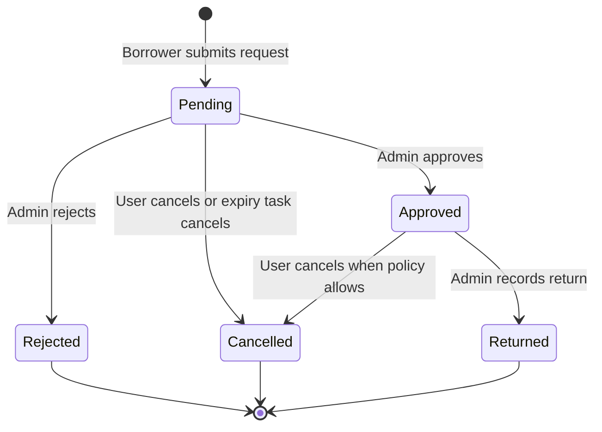

# Borrowing and Equipment Lifecycle

Booking states and equipment inventory states are separate. Their current values are defined in [`BookingStatus`](../../backend/app/Enums/BookingStatus.php) and [`EquipmentStatus`](../../backend/app/Enums/EquipmentStatus.php).

## Booking states

The persisted booking statuses are `pending`, `approved`, `rejected`, `returned`, and `cancelled`. There is no persisted `released` state or barcode release transition. `is_overdue` is computed for an approved booking whose end date has passed; it is not a stored booking status. See [`Booking`](../../backend/app/Models/Booking.php) and [`BookingController`](../../backend/app/Http/Controllers/Api/V1/BookingController.php).

| Status | Meaning |
| --- | --- |
| `pending` | Waiting for an administrator's decision. |
| `approved` | Approved and included in active booking checks. |
| `rejected` | Rejected by an administrator. |
| `returned` | Return recorded by an administrator. |
| `cancelled` | Cancelled by a user or by the expiry task. |

## Equipment states

Equipment status values are `available`, `booked`, `borrowed`, and `maintenance`. [`Equipment::resolveStatuses`](../../backend/app/Models/Equipment.php) reports equipment tied to an approved booking as `booked`, unless its stored status is `maintenance`. This does not perform a time-based transition to `borrowed`. Returning a booking changes its booking status and return fields; it does not directly set an equipment status to `available`.

The booking form can offer equipment with a `booked` status when the requested interval does not overlap an approved booking. Maintenance equipment is excluded from availability. Availability checks are repeated while booking transitions run in a transaction with equipment locks; preserve these checks when changing booking logic.

## Request validation and dates

[`StoreBookingRequest`](../../backend/app/Http/Requests/Api/V1/StoreBookingRequest.php) validates the requested equipment and dates. The start must be at or after the current minute; earlier minutes are rejected. The server checks conflicts against approved bookings. The request stores timezone-naive `DATETIME` values, so the database values are not inherently UTC. Eloquent serializes date casts as UTC ISO timestamps; do not derive a Manila calendar date by slicing that timestamp. The API resource formats date labels in `Asia/Manila`, and the frontend uses [`frontend/shared/util/date.js`](../../frontend/shared/util/date.js) to parse and display booking dates consistently.

The request summary uses [`useBookingDateDefaults`](../../frontend/web/src/features/borrow/request/useBookingDateDefaults.js). While open, an automatic start follows the current minute and an automatic end is set to the next full hour (for example, 3:08 becomes 4:00). Manually selected dates are preserved while editing; closing and reopening resets the automatic defaults. There is no fixed school-hours restriction.

## Booking integrity

- A booking request needs at least one equipment item.
- A request with multiple equipment IDs creates one booking per item in the same database transaction, so each item has its own ticket and lifecycle.
- Equipment conflict checks use approved bookings and half-open intervals: an existing booking conflicts when its start is before the requested end and its end is after the requested start. Pending requests do not reserve equipment.
- Approval rechecks availability under transaction locks. Do not remove the lock or conflict recheck when changing transitions.
- Equipment with booking history cannot be deleted, preserving transaction records.

The model observers broadcast booking and equipment updates. [`BookingUpdated`](../../backend/app/Events/BookingUpdated.php) dispatches after commit; [`EquipmentUpdated`](../../backend/app/Events/EquipmentUpdated.php) broadcasts immediately. These observers do not invalidate frontend query caches; the web client handles its own query invalidation and WebSocket refresh behavior.
