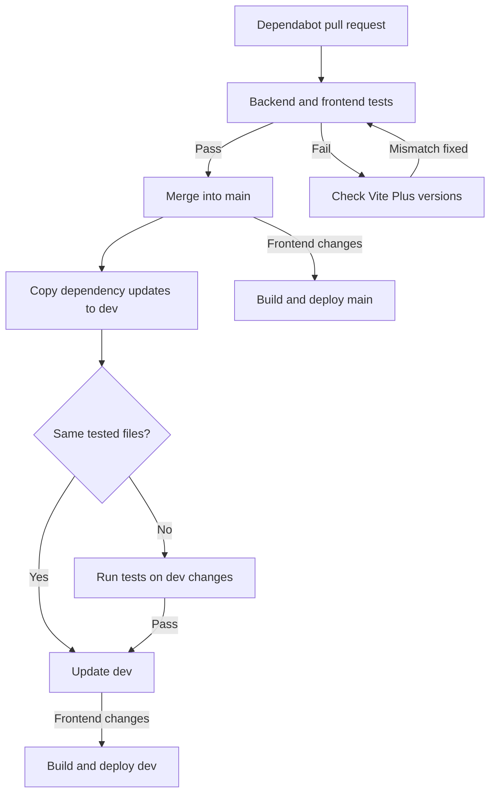

# GitHub Actions

## Tests

[Tests](../../.github/workflows/tests.yml) runs the backend and frontend checks on pull requests. The deployment workflow also runs these checks when it cannot verify that the same code has already passed.

## Dependency updates

Dependabot checks Composer and Bun dependencies daily and groups updates in pull requests targeting `main`. The [dependency workflow](../../.github/workflows/dependencies.yml) merges a Dependabot pull request after the tests pass. If a Vite Plus version mismatch causes a test failure, it can align the versions and update the pull request.

After a Dependabot update reaches `main`, the [sync workflow](../../.github/workflows/sync-dependencies.yml) copies the missing Dependabot commits to `dev`. It reuses a verified test result when the files match; otherwise, it tests the combined code before updating `dev`. A conflict stops the sync for manual resolution.

The sync and Vite Plus repair use a GitHub App. The repository must have the `VITE_SYNC_APP_ID` variable and `VITE_SYNC_APP_PRIVATE_KEY` secret configured. Branch rules must allow the app to update `dev` and Dependabot branches.

## Firebase deployment

The [deployment workflow](../../.github/workflows/deploy.yml) builds and deploys the frontend to Firebase Hosting for `main` and `dev`. It runs after relevant frontend changes or by manual request. Tests must pass, or an existing verified result must match the commit, before deployment.
